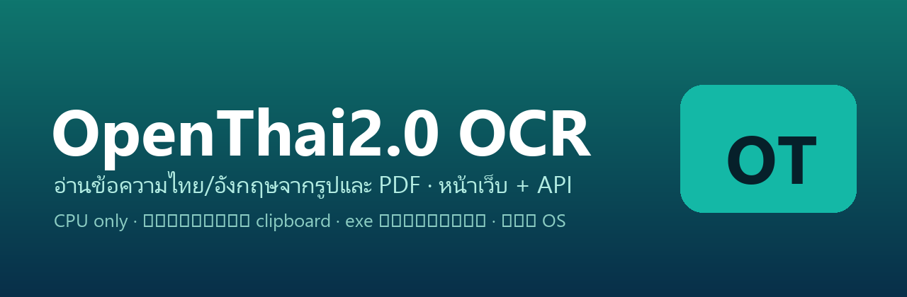

# OpenThai2.0 OCR — Web UI + API

[ไทย](README.md) | **English**

A web app that reads Thai/English text from **images and PDFs**, running locally on CPU.
Powered by the [`iapp/OpenThai2.0-OCR-Text`](https://huggingface.co/iapp/OpenThai2.0-OCR-Text) model (Apache-2.0),
with a Thai/English web UI, clipboard paste, a JSON API for other programs, and a single-file executable build.



## Highlights

- **Paste images instantly** — drag & drop, pick files, or `Ctrl+V` a screenshot (Snipaste / Print Screen)
- **Multiple files / pages** — several images or a multi-page PDF, results in tabs
- **Boxes on the image** — each line is outlined with its confidence score
- **Font size follows the screen** — `A− A A+` buttons, remembered in the browser
- **Progress + cancel** — know which page a long PDF is on and stop mid-way
- **Exports** — searchable PDF, Word (.docx), CSV (Excel-friendly), JSON, TXT
- **Line-level copy** — expand every line with its confidence and copy just the one you need
- **Watch folder** — `--watch` auto-OCRs new files into .txt/.docx/.json
- **Ready-to-use API** — multipart / JSON base64 / background jobs, CORS enabled, 8 language examples
- **Basic safety** — 100 MB / 50 page limits, optional API key for LAN mode, log file
- **Thai/English UI toggle** — EN/ไทย button (remembered) plus an in-app Quit button
- **No GPU required** — ONNX Runtime on CPU, roughly 0.1–0.5 s per A4 page
- **A single file** — `OpenThai2OCR.exe` embeds the model; or build your own on Linux/macOS

## Quick start (Windows)

1. Download `OpenThai2OCR-windows-x64.exe` from [Releases](../../releases)
2. Double-click it — your browser opens `http://127.0.0.1:5000`
3. Drop an image/PDF, or press `Ctrl+V` to paste a screenshot — text appears immediately

> The first launch takes a few seconds because the single-file build extracts itself to a temp folder.

## Run from source (any OS)

```bash
python -m pip install -r requirements.txt
python app.py                # opens http://127.0.0.1:5000
python app.py --no-browser   # do not open a browser
python app.py --host 0.0.0.0 --port 8080   # allow other machines on the LAN
python app.py --watch "D:\inbox"           # OCR new files dropped into a folder
```

Config: use the **Settings** page (`/settings`, local machine only, validates values, restart to apply) or put keys in `settings.json` (next to the exe or `%LOCALAPPDATA%\OpenThai2OCR\`; see
`settings.example.json`). Precedence: CLI flag > settings.json > built-in default; restart to apply.
Keys: `host`, `port`, `port_tries`, `model_dir`, `log_dir`, `log_level`, `watch_dir`, `watch_out`,
`watch_interval`, `max_upload_mb`, `max_pages`, `result_keep`, `max_edit_chars`, `server_threads`,
`engine_threads`, `pdf_zoom`, `annotate_max_width`, `api_key`, `cors_origin`, `update_timeout`,
`update_ttl_hours`. Invalid values are ignored with a warning in the log.

## Build an executable

```bat
build_exe.bat          :: Windows — single file dist\OpenThai2OCR.exe (model embedded)
build_exe_onedir.bat   :: Windows — folder dist\OpenThai2OCR\ (faster startup)
```

Linux / macOS:

```bash
python -m pip install -r requirements.txt -r requirements-build.txt
pyinstaller OpenThai2OCR.spec --noconfirm --clean
```

## API at a glance

```bash
curl -F "file=@page.png" "http://127.0.0.1:5000/api/ocr"
```

```php
$ch = curl_init('http://127.0.0.1:5000/api/ocr');
curl_setopt_array($ch, [CURLOPT_RETURNTRANSFER => true, CURLOPT_POST => true,
    CURLOPT_POSTFIELDS => ['file' => new CURLFile('page.jpg')]]);
$res = json_decode(curl_exec($ch), true);
echo $res['text'];
```

Full details (JSON base64, jobs/progress, exports, API key, `scale`/`settings`) → [docs/API.en.md](docs/API.en.md)

## Documentation

| File | Contents |
|---|---|
| [docs/USAGE.en.md](docs/USAGE.en.md) | User guide + accuracy tuning (English) |
| [docs/USAGE.md](docs/USAGE.md) | คู่มือการใช้งาน (ภาษาไทย) |
| [docs/API.en.md](docs/API.en.md) | API reference + examples (English) |
| [docs/API.md](docs/API.md) | API reference (ภาษาไทย) |
| [docs/BUILD.en.md](docs/BUILD.en.md) | Building and releasing (English) |
| [CHANGELOG.md](CHANGELOG.md) | Version history |

## Limitations

- The model is trained on **printed text** — handwriting and scene text are weak
- Low-resolution screenshots may misread a few characters — try image scale 2×
- Stamps and seals come out as text (they are text on the page)

## Credits / License

- This project's code: [Apache-2.0](LICENSE)
- Model and runtime: © iApp Technology — `iapp/OpenThai2.0-OCR-Text` (Apache-2.0)
- Base detector/recognizer: PaddlePaddle PP-OCRv6-tiny (Apache-2.0) — see [NOTICE](NOTICE)