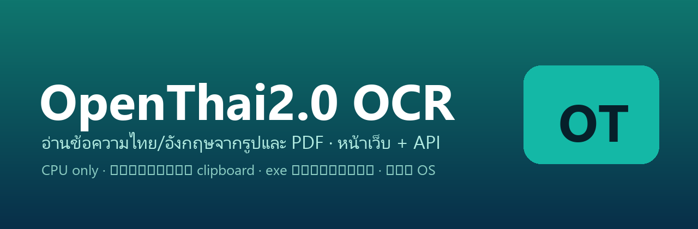

# OpenThai2.0 OCR — Web UI + API

**ไทย** | [English](README.en.md)

หน้าเว็บอ่านข้อความไทย/อังกฤษจาก **รูปภาพและ PDF** ทำงานบนเครื่องตัวเอง (CPU) ใช้โมเดล
[`iapp/OpenThai2.0-OCR-Text`](https://huggingface.co/iapp/OpenThai2.0-OCR-Text) (Apache-2.0)
พร้อมหน้าเว็บภาษาไทย, วางภาพจาก clipboard, API JSON สำหรับเรียกจากโปรแกรมอื่น และ build เป็น exe ไฟล์เดียว



## จุดเด่น

- **วางภาพได้ทันที** — ลากไฟล์, เลือกไฟล์ หรือกด `Ctrl+V` วางภาพที่คัดลอกมา (Snipaste / Print Screen)
- **รองรับหลายไฟล์/หลายหน้า** — รูปหลายรูปหรือ PDF หลายหน้า แยกแท็บผลลัพธ์ให้
- **แสดงผลพร้อมกล่องข้อความ** — วาดกรอบแต่ละบรรทัดพร้อมค่าความมั่นใจบนภาพ
- **ปรับขนาดตัวอักษรตามจอ** — ปุ่ม `A− A A+` จำค่าไว้ในเบราว์เซอร์
- **แถบความคืบหน้า + ยกเลิก** — PDF หลายหน้ารู้ว่าอ่านถึงหน้าไหน หยุดได้กลางทาง
- **ส่งออกได้หลายแบบ** — PDF ที่ค้นหาข้อความได้, Word (.docx), CSV (เปิด Excel), JSON, TXT
- **คัดลอกทีละบรรทัด** — กางรายการทุกบรรทัดพร้อมค่าความมั่นใจ แล้วคัดลอกเฉพาะที่ต้องการ
- **เฝ้าโฟลเดอร์อัตโนมัติ** — `--watch` วางไฟล์ลงโฟลเดอร์แล้วได้ .txt/.docx/.json ทันที
- **API พร้อมใช้** — multipart / JSON base64 / งานเบื้องหลัง (jobs), เปิด CORS, ตัวอย่าง 8 ภาษา
- **ความปลอดภัยพื้นฐาน** — จำกัดขนาดไฟล์ 100 MB / 50 หน้า, มี API key สำหรับโหมด LAN, log ไฟล์
- **สลับภาษาไทย/อังกฤษในหน้าเว็บได้** — ปุ่ม EN/ไทย (จำค่าไว้) และปุ่มปิดโปรแกรมในตัว
- **ไม่ต้องใช้ GPU** — ONNX Runtime บน CPU ประมาณ 0.1–0.5 วินาทีต่อหน้า A4
- **ไฟล์เดียวจบ** — `OpenThai2OCR.exe` ฝังโมเดลไว้ในตัว แจกจ่ายได้เลย (Windows)
  หรือ build เองบน Linux/macOS

## เริ่มใช้เร็วสุด (Windows)

1. ดาวน์โหลด `OpenThai2OCR-windows-x64.exe` จากหน้า [Releases](../../releases)
2. ดับเบิลคลิก — เบราว์เซอร์จะเปิดที่ `http://127.0.0.1:5000`
3. ลากรูป/PDF มาวาง หรือกด `Ctrl+V` วางภาพหน้าจอ → ได้ข้อความทันที

> ครั้งแรกอาจใช้เวลาหลายวินาทีเพราะต้องแตกไฟล์ภายในออกมาที่ temp

### ถ้า Windows / macOS เตือนตอนเปิดครั้งแรก

ไฟล์ที่ปล่อยยัง **ไม่ได้เซ็นดิจิทัล (code signing)** จึงอาจเจอคำเตือน — ไม่ได้แปลว่าไฟล์อันตราย:

| ระบบ | อาการ | วิธีเปิด |
|---|---|---|
| Windows | "Windows protected your PC" / Unknown publisher | กด **More info** → **Run anyway** |
| Windows | แอนตี้ไวรัสบางตัวแจ้งผิด (false positive) | ตรวจ SHA256 (ด้านล่าง) แล้วเพิ่มไฟล์เป็นข้อยกเว้น |
| macOS | "ไม่สามารถเปิดได้เพราะไม่ทราบผู้พัฒนา" | คลิกขวาที่ไฟล์ → **Open** หรือรัน `xattr -d com.apple.quarantine ./OpenThai2OCR-macos-arm64` |
| Linux | รันไม่ได้ (Permission denied) | `chmod +x ./OpenThai2OCR-linux-x64` |

**ตรวจว่าไฟล์ไม่ถูกแก้ไข:** เทียบ SHA256 กับตารางในหน้า release ของเวอร์ชันนั้น

```powershell
Get-FileHash .\OpenThai2OCR-windows-x64.exe -Algorithm SHA256
```

```bash
sha256sum ./OpenThai2OCR-linux-x64        # macOS: shasum -a 256 <ไฟล์>
```

ไฟล์ทุกตัวถูก build โดย GitHub Actions จากซอร์สโค้ดสาธารณะใน repo นี้ (ดู [release.yml](.github/workflows/release.yml))
และผ่านการทดสอบรันจริงก่อนปล่อยทุกครั้ง

## รันจากซอร์สโค้ด (ทุก OS)

```bash
python -m pip install -r requirements.txt
python app.py                # เปิด http://127.0.0.1:5000
python app.py --window       # เปิดในหน้าต่างโปรแกรม (GUI, WebView2)
python app.py --no-browser   # ไม่เปิดอะไร (headless — จำค่าได้ในหน้าเว็บ)
python app.py --browser      # บังคับเปิดเบราว์เซอร์ (ข้ามค่าที่จำไว้)
python app.py --host 0.0.0.0 --port 8080   # ให้เครื่องอื่นใน LAN เรียกได้
python app.py --watch "D:\inbox"           # เฝ้าโฟลเดอร์ แล้วอ่านไฟล์ใหม่อัตโนมัติ
```

> Windows: ดับเบิลคลิก `run_web.bat` ก็ได้ (ใช้ `.venv` ถ้ามี · ตรวจ Python/dependency ให้ · ส่งอาร์กิวเมนต์ต่อให้ `app.py` เช่น `run_web.bat --port 5100 --window`)

> ค่าเริ่มต้นของ "เมื่อเริ่มโปรแกรม" (หน้าต่างโปรแกรม / เบราว์เซอร์ / ไม่เปิดอะไร)
> ตั้งได้ในหน้าแรก และจำไว้ที่ `settings.json` (เขียนทั้งข้าง exe และ
> `%LOCALAPPDATA%\OpenThai2OCR\settings.json` เพื่อให้ใช้ร่วมกันทุกที่วาง exe)

### ตั้งค่าเอง (`settings.json`)

แก้ในหน้าเว็บ **ตั้งค่า** (`/settings`) ได้เลย — ตรวจค่าให้ มีปุ่มกลับค่าเริ่มต้น และเตือนว่าต้องรีสตาร์ต
(เปิดได้เฉพาะจากเครื่องที่รันโปรแกรม) · หรือใส่ key เองลงใน `settings.json` (ข้าง exe หรือ
`%LOCALAPPDATA%\OpenThai2OCR\`) ดูตัวอย่างที่ `settings.example.json` · **ลำดับความสำคัญ: flag CLI > settings.json > ค่าเริ่มต้น** · ต้องรีสตาร์ตโปรแกรมจึงมีผล
ค่าที่ผิดชนิด/เกินช่วงจะถูกข้ามและเตือนใน log (`logs/openthai-ocr.log`) · path แบบ relative อิงโฟลเดอร์ข้างโปรแกรม
(รองรับ `~` และ `%VAR%`) · ถ้าตั้ง `api_key` ในไฟล์ ให้ระวังสิทธิ์อ่านไฟล์นี้

| key | flag CLI | ค่าเริ่มต้น | ความหมาย |
|---|---|---|---|
| `host` | `--host` | `127.0.0.1` | ที่อยู่ที่เปิดฟัง (`0.0.0.0` = ทั้ง LAN, ต้องมี `api_key`) |
| `port` / `port_tries` | `--port` / `--port-tries` | `5000` / `11` | พอร์ตเริ่มต้น และจำนวนพอร์ตที่ลองไล่ถ้าไม่ว่าง |
| `model_dir` | `--model` | `models/` | โฟลเดอร์โมเดล |
| `log_dir` / `log_level` | `--log-dir` / `--log-level` | `logs/` / `INFO` | ที่เก็บ log และระดับ |
| `watch_dir` / `watch_out` / `watch_interval` | `--watch` / `--watch-out` / `--watch-interval` | ว่าง / ว่าง / `5` | เฝ้าโฟลเดอร์ (วินาที ≥ 1) |
| `max_upload_mb` | `--max-upload-mb` | `100` | ขนาดไฟล์อัปโหลดสูงสุด |
| `max_pages` | `--max-pages` | `50` | จำนวนหน้า PDF สูงสุด |
| `result_keep` / `max_edit_chars` | — | `5` / `2000000` | ผลลัพธ์ที่เก็บในหน่วยความจำ / ความยาวข้อความที่แก้ได้ |
| `server_threads` / `engine_threads` | `--threads` / `--engine-threads` | `8` / `2` | thread ของเซิร์ฟเวอร์ / engine OCR |
| `pdf_zoom` / `annotate_max_width` | — | `1.6` / `1200` | ซูมตอนแปลง PDF เป็นภาพ / ความกว้างสูงสุดของภาพที่ส่งกลับ |
| `api_key` | `--api-key` | ว่าง | กำหนด API key (ว่าง = ไม่ตรวจ ยกเว้นเปิด LAN จะสุ่มให้) |
| `cors_origin` | — | `*` | ค่า `Access-Control-Allow-Origin` (`""` = ปิด CORS) |
| `update_timeout` / `update_ttl_hours` | — | `5` / `6` | timeout และอายุแคชของการเช็กอัปเดต |

### หน้าในเว็บ

| หน้า | ใช้ทำอะไร |
|---|---|
| `/` | อ่าน OCR จากรูป/PDF |
| `/docs` | สอนเชื่อมต่อ API + ตัวอย่างโค้ด curl / Python / JS / PHP / C# |
| `/playground` | ยิงคำขอ OCR จริงจากเบราว์เซอร์ ดู JSON/เวลา/ความมั่นใจ และดาวน์โหลดผล |
| `/status` | สถานะระบบ งานล่าสุด watch folder และขีดจำกัด |

## build เป็น exe

```bat
build_exe.bat          :: Windows — ไฟล์เดียว dist\OpenThai2OCR.exe (ฝังโมเดล)
build_exe_onedir.bat   :: Windows — โฟลเดอร์ dist\OpenThai2OCR\ (โหลดเร็วกว่า)
```

สคริปต์ build จะ: ติดตั้ง dependency → รัน `pytest` → build → เปิด exe ที่ได้มารันจริง 1 ครั้ง
(`tools\exe_smoke.py`: health → OCR → ปิด) แล้วค่อยแจ้งว่าสำเร็จ · ใช้ `.venv\Scripts\python.exe` ถ้ามี
· ข้ามเทสต์ด้วย `build_exe.bat --skip-tests`

Linux / macOS:

```bash
python -m pip install -r requirements.txt -r requirements-build.txt
pyinstaller OpenThai2OCR.spec --noconfirm --clean
```

## API ย่อ

```bash
curl -F "file=@page.png" "http://127.0.0.1:5000/api/ocr"
```

```php
$ch = curl_init('http://127.0.0.1:5000/api/ocr');
curl_setopt_array($ch, [CURLOPT_RETURNTRANSFER => true, CURLOPT_POST => true,
    CURLOPT_POSTFIELDS => ['file' => new CURLFile('page.jpg')]]);
$res = json_decode(curl_exec($ch), true);
echo $res['text'];
```

รายละเอียดทั้งหมด (JSON base64, jobs/progress, export, API key, ตัวเลือก `scale`/`settings`) → [docs/API.md](docs/API.md)

## เอกสาร

| ไฟล์ | เนื้อหา |
|---|---|
| [docs/USAGE.md](docs/USAGE.md) | คู่มือการใช้งาน + การปรับแต่งความแม่นยำ (ไทย) |
| [docs/USAGE.en.md](docs/USAGE.en.md) | User guide + accuracy tuning (English) |
| [docs/API.md](docs/API.md) | API reference + ตัวอย่าง 8 ภาษา (ไทย) |
| [docs/API.en.md](docs/API.en.md) | API reference + 8 language examples (English) |
| [docs/BUILD.md](docs/BUILD.md) | build exe / release ทุก OS (ไทย) |
| [docs/BUILD.en.md](docs/BUILD.en.md) | Build & release (English) |
| [CHANGELOG.md](CHANGELOG.md) | ประวัติเวอร์ชัน |

## ข้อจำกัด

- โมเดลนี้อ่าน **ตัวพิมพ์ (printed text)** เป็นหลัก — ลายมือและป้ายในภาพถ่ายกลางแจ้งจะอ่านได้ไม่ดี
- ภาพความละเอียดต่ำ/ตัวอักษรเล็กมากอาจอ่านผิดบางตัว — ลองตั้ง "ความละเอียดภาพ" เป็น 2×
- ตราประทับ/ลายเซ็นอาจถูกอ่านออกมาเป็นข้อความ (เพราะเป็นตัวอักษรบนกระดาษ)

## เครดิต / สัญญาอนุญาต

- โค้ดโปรเจกต์นี้: [Apache-2.0](LICENSE)
- โมเดลและ runtime: © iApp Technology — `iapp/OpenThai2.0-OCR-Text` (Apache-2.0)
- ต้นแบบ detector/recognizer: PaddlePaddle PP-OCRv6-tiny (Apache-2.0) — ดู [NOTICE](NOTICE)